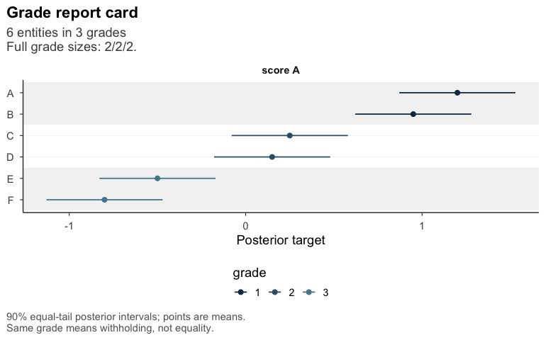
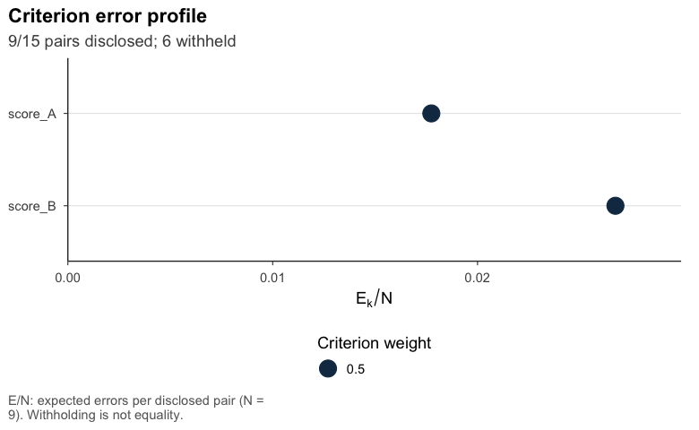
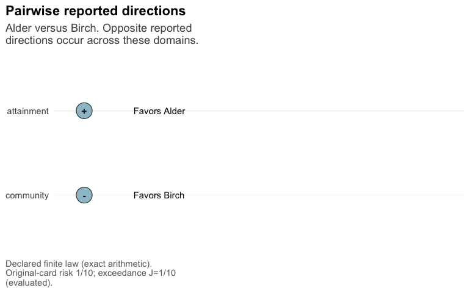

<!-- README source: README.Rmd. -->

# postrank 

Author and maintainer: JoonHo Lee (<jlee296@ua.edu>).

`postrank` assigns integer grades (`1, 2, ..., G`) to entities—such as
schools, employers, or geographic areas—from posterior draws, normal or
mixture distributions, or precomputed pairwise comparison probabilities
on one or several criteria. Grade 1 denotes the highest priority.
Assigning two entities to different grades reports an ordering between
them; assigning them to the same grade leaves the pair unordered rather
than claiming that their underlying values are equal.

Grades minimize posterior expected wrong-direction errors (cost `1`)
plus a cost `tau` for each pair left unordered in the same grade,
averaged over all entity pairs. Across multiple criteria, user-chosen
weights combine criterion-specific losses into one common grading, or
the multidomain functions (`postrank_mdomain_*`) report a separate grade
per domain under joint error-exceedance caps. Statistical model fitting
takes place outside `postrank`; all results are conditional on the
posterior you supply.

## Installation and solvers

Install `postrank` from [GitHub](https://github.com/joonho112/postrank):

``` r
install.packages("remotes")
remotes::install_github("joonho112/postrank")
library(postrank)
```

Loading bundled datasets, reading precomputed examples with
`postrank_example()`, extracting tables, drawing plots, writing HTML
reports, and running multidomain profile calculations do not require an
optimization solver.

Computing new common-grade solutions with `postrank()` or
`postrank_solve()` requires a mixed-integer solver, installed
separately:

- **HiGHS (free, open source on CRAN):** install once and set it for the
  R session with:

  ``` r
  install.packages("highs")
  options(postrank.backend = "highs")
  ```

- **Gurobi (default when no solver is specified):** requires Gurobi
  Optimizer version 10 or later, a valid license, and the `gurobi` R
  package from the `R` subdirectory of the Gurobi installation. Follow
  Gurobi’s guides to install [Gurobi
  Optimizer](https://support.gurobi.com/hc/en-us/articles/4534161999889-How-do-I-install-Gurobi-Optimizer),
  set up a
  [license](https://support.gurobi.com/hc/en-us/articles/12872879801105-How-do-I-retrieve-and-set-up-a-Gurobi-license),
  and install the [R
  interface](https://support.gurobi.com/hc/en-us/articles/14462206790033-How-do-I-install-Gurobi-for-R).

An explicit `backend = "highs"` or `backend = "gurobi"` argument
overrides `getOption("postrank.backend")`; if neither is set, `"gurobi"`
is used. If the selected solver is not installed or cannot be loaded,
`postrank` stops with an error; it never switches to the other solver,
even if a run reaches its time limit or encounters solver trouble.

### Case-study data conditions

The three bundled case-study datasets are adapted from public sources
and keep their source-specific conditions, separate from the MIT code
license: `pr_case_cde` preserves California Department of Education
source attribution (2025–26 Dashboard) without substituting MIT or
Creative Commons terms or implying CDE endorsement; `pr_case_krw`
retains the noncommercial `CC-BY-NC` notice (license version unspecified
in the source) from Kline, Rose, and Walters (2024; openICPSR
`E198284V1`); and `pr_case_alabama` retains `CC BY 4.0` attribution to
Opportunity Insights and the U.S. Census Bureau (Chetty et al., 2022;
Harvard Dataverse `doi:10.7910/DVN/NKCQM1`). Full details and adaptation
notes are in
`system.file("extdata", "case-studies", "DATA-NOTICE.md", package = "postrank")`.

## First example: one criterion

`pr_tutorial` contains six synthetic sites (`A` through `F`) whose score
distributions are specified directly as independent normal posteriors
with standard deviation `0.2` (higher values mean higher priority;
simulated teaching data, not empirical observations).

With HiGHS installed, run `postrank()` directly:

``` r
one <- postrank(pr_tutorial$one, tau = .2, G_max = 3L,
  backend = "highs",
  control = postrank_control(time_limit = 60, threads = 1L, seed = 1304L))
```

Without running a solver, load the precomputed result from an equivalent
call with `postrank_example()`. These stored results were computed with
the explicitly selected highs backend (`backend = "highs"`) under the
settings shown above (`G_max = 3L` caps the report at three occupied
grades, and a single criterion receives weight `1`):

``` r
one <- postrank_example("tutorial_one")
one
#> <postrank_analysis>  6 entities in 3 grades (sizes 2 / 2 / 2)
#>   One criterion: score_A.
#>   Posterior loss: 0.0417.
#>   Disclosed 12 of 15 pairs (80.0%); withheld 3.
#>   Expected error among disclosed pairs: score_A 0.002.
#>   Solver: Optimal within solver tolerances.
#>   Optimization gap: 0; requested absolute gap 1e-08.
#>   Prepared: report card.
#>   Grade 1 has highest priority; a shared grade withholds the comparison.
#>   grade 1 (2): A, B
#>   grade 2 (2): C, D
#>   grade 3 (2): E, F
#>   !  1 warning recorded: Reported lower bound exceeded the validated action r...
#>   i summary(x) explains the loss, settings and bounds; get_grades(x) returns
#>     all grades.
```

In the console output, `"Disclosed"` counts ordered pairs, `"withheld"`
counts unordered pairs (shared grades), and the recorded warning notes
that floating-point tolerances placed the raw solver lower bound
slightly above the checked grading’s loss (`"validated action risk"`),
so `postrank` clamped the bound to the loss and recorded gap `0`.

Extract the two-column `(entity_id, grade)` table in input entity order:

``` r
as.data.frame(one)
#>   entity_id grade
#> 1         A     1
#> 2         B     1
#> 3         C     2
#> 4         D     2
#> 5         E     3
#> 6         F     3
```

Plot the report card with `postrank_plot_report_card(one)` (or
`plot(one)`) to view the assigned grades alongside 90% marginal
posterior intervals for each site’s score (these intervals summarize
score uncertainty one site at a time and do not assign probabilities to
grade labels):

``` r
postrank_plot_report_card(one)
```



## A common grading across two criteria

`pr_tutorial$two` adds `score_B` while keeping the `score_A` posterior
for the same six sites. With multiple criteria, `weights` is a required
policy choice that sets how wrong-direction errors trade off across
criteria (neither score units nor posterior spread determine the
weights):

``` r
two <- postrank(pr_tutorial$two,
  weights = c(score_A = .5, score_B = .5), tau = .2, G_max = 3L,
  backend = "highs",
  control = postrank_control(time_limit = 60, threads = 1L, seed = 1304L))
```

``` r
two <- postrank_example("tutorial_two")
two
#> <postrank_analysis>  6 entities in 3 grades (sizes 4 / 1 / 1)
#>   2 criteria: score_A, score_B.
#>   Posterior loss: 0.0933.
#>   Disclosed 9 of 15 pairs (60.0%); withheld 6.
#>   Expected error among disclosed pairs: score_A 0.018; score_B 0.027.
#>   Solver: Optimal within solver tolerances.
#>   Optimization gap: 0; requested absolute gap 1e-08.
#>   Prepared: report card.
#>   Grade 1 has highest priority; a shared grade withholds the comparison.
#>   grade 1 (4): A, B, C, D
#>   grade 2 (1): E
#>   grade 3 (1): F
#>   i summary(x) explains the loss, settings and bounds; get_grades(x) returns
#>     all grades.
```

One shared grading now applies to both criteria, leaving unordered
several pairs that were separated on `score_A` alone.
`postrank_plot_profile()` shows the expected wrong-direction errors per
ordered pair (`E/N`) on each criterion:

``` r
postrank_plot_profile(two)
```



Solver status, lower bound, and optimization gap describe optimization
over the supplied comparison probabilities; posterior model adequacy and
Monte Carlo simulation error require separate checks.

## Passing your own posterior draws

To grade entities from your own `draws x entities x criteria` numeric
array, describe the posterior in plain arguments with
`postrank_describe()` and wrap the array with `postrank_draws()`:

``` r
set.seed(901)
arr <- array(rnorm(120 * 4 * 1), dim = c(120, 4, 1),
  dimnames = list(NULL, paste0("site_", 1:4), "need"))
decl <- postrank_describe(
  estimand = c(need = "Latent site need in a specified standard normal law"),
  population = "Four illustrative sites", time = "Static illustration",
  units = "Standardized need units", data = "No external observations; specified law",
  model = "Independent standard normal coordinates",
  identification = "Each site coordinate is defined directly by the law.",
  joint = "Each draw holds one value per site.",
  sampling = "120 independent rnorm() draws after set.seed(901); no warmup or thinning.",
  ties = "Continuous normal coordinates have zero probability of exact equality.",
  software = "Base R rnorm()", source = "In-memory array arr",
  label = "readme-draws", data_version = "1", values = arr)
draws <- postrank_draws(arr, regime = "iid", declarations = decl)
draws$entity_ids
#> [1] "site_1" "site_2" "site_3" "site_4"
```

Other posterior representations have matching constructors:

| Posterior representation | Functions |
|:---|:---|
| Posterior draw arrays, matrix lists, or `posterior::draws_array` | `postrank_describe()`, `postrank_declarations()`, `postrank_draws()`, `as_postrank_posterior()` |
| Analytic normal or shared-state normal mixture posterior | `postrank_gaussian_coefficients()`, `postrank_mixture_coefficients()` |
| Precomputed tie-free pairwise comparison probabilities | `postrank_probabilities()` |
| Posteriors with positive probability of exact equality | `as_postrank_tie_draws()`, `postrank_tie_pairwise()`, `postrank_tie_solve()` |
| Separate grade per domain under joint error-exceedance caps | `postrank_mdomain_input()`, `postrank_mdomain_decision()`, `postrank_mdomain_solve()` |

Validation checks array shapes, probability bounds, and internal
consistency with your declarations; scientific assumptions remain yours.

## Multidomain profile report cards

When entities should receive a separate grade in each domain rather than
one common grade—for example, when priorities reverse across domains—the
`postrank_mdomain_*` functions evaluate entity-by-domain grade matrices
and search declared candidate sets under exact rational policy
thresholds (via the optional `gmp` package, with no mixed-integer solver
required):

``` r
if (requireNamespace("gmp", quietly = TRUE)) {
  ids <- c("Alder", "Birch")
  domains <- c("attainment", "community")
  x <- array(c(3, 2, 2, 3, 2, 3, 3, 2), c(2L, 2L, 2L),
    dimnames = list(c("usual", "reversal"), ids, domains))
  targets <- setNames(lapply(domains, function(d) list(
    definition = paste("Fictional", d, "priority coordinate"),
    units = "illustrative score", orientation = "larger_is_higher",
    equality_classes = setNames(ids, ids),
    equality_provenance = "No structural identity between distinct units."
  )), domains)
  provenance <- list(input_id = "readme-support", law_id = "readme-law",
    proper_law = TRUE, producer = "Self-contained teaching example",
    joint_generation = "Each slice is one complete state of both domains.",
    sampling_assumptions = list(finite_support_origin =
      "These two states exhaust the specified fictional law."))
  input <- postrank_mdomain_input(x, targets = targets, provenance = provenance,
    representation = "exact_finite_law", masses = c("9/10", "1/10"))
  decision <- postrank_mdomain_decision(tau = "1/5", t = "0", alpha = "1/5")
  G <- matrix(c(1, 2, 2, 1), 2L, dimnames = list(ids, domains))
  card <- postrank_mdomain_evaluate(input, G, decision)
  print(postrank_mdomain_grades(card))
  print(postrank_plot_mdomain(card, view = "pair", units = ids))
} else {
  message("Multidomain example skipped: install the optional package 'gmp'.")
}
#>       attainment community
#> Alder          1         2
#> Birch          2         1
```



Pass exact rational or decimal strings such as `"1/5"` when policy
thresholds are exact fractions. Optimality in `postrank_mdomain_solve()`
holds within the declared candidate set, and exact arithmetic over a
finite distribution or sample does not verify model specification.

## Extracting results and where to read next

``` r
as.data.frame(two, what = "report_card")
get_profile(two)
get_relations(two)
postrank_report(two$fit, output_file = tempfile(fileext = ".html"), analysis = two)
postrank_plot_pairwise(two)               # pairwise error probabilities
postrank_plot_relations(two)              # ordered and unordered pairs
format(two, width = 72, tier = 2)         # plain-text summary lines
```

The 16 shipped vignettes are organized by workflow stage (browse with
`vignette(package = "postrank")` or on the [package
website](https://joonho112.github.io/postrank/)):

- **Start here:** `a1-getting-started` (first one- and two-criterion
  analyses), `a5-your-posterior-results` (passing draws, normal/mixture
  posteriors, or pairwise probabilities), `a6-reading-exporting-results`
  (tables, plots, text, and HTML reports), and `a7-figures-sensitivity`
  (baseline comparisons, `tau` frontiers, error budgets, and sensitivity
  grids).
- **Applied case studies:** `a2-cde-accountability` (California
  schools), `a3-krw-race-gender` (97 large U.S. employers), and
  `a4-alabama-opportunity` (67 Alabama counties).
- **Multidomain profiles:** `mdomain-quickstart` and `mdomain-decisions`
  (separate per-domain grades and joint error-exceedance protection).
- **Methods and figure gallery:** `m1-ranking-and-loss`,
  `m2-several-criteria`, `m3-posterior-inputs`,
  `m4-ties-and-withholding`, `m5-computing-grades`,
  `m6-uncertainty-diagnostics`, and `figure-gallery`. Release
  compatibility notes are in
  `system.file("MIGRATION-1.2.0.md", package = "postrank")`.

## Citation

`citation("postrank")` returns the package, its theory book, and the
report-card method:

1.  **R package.** Lee, J. (2026). *postrank: Posterior Ranking with
    Integer Grades*. R package version 1.3.0. [GitHub
    repository](https://github.com/joonho112/postrank) · [Package
    documentation](https://joonho112.github.io/postrank/).

2.  **Theory book.** Lee, J. (2026). *Decisions from noisy
    multidimensional indicators: Theory, evidence, and posterior
    grading* (Version 1.0.0). Zenodo.
    <https://doi.org/10.5281/zenodo.23790260>. [Read
    online](https://joonho112.github.io/postrank-theory-book/).

3.  **Report-card method.** Kline, P., Rose, E. K., and Walters, C. R.
    (2024). A discrimination report card. *American Economic Review*,
    114(8), 2472–2525. <https://doi.org/10.1257/aer.20230700>.

## Acknowledgments

The research underlying this package was supported primarily by the
National Academy of Education and the Spencer Foundation through the
2025 National Academy of Education/Spencer Postdoctoral Fellowship.

The research reported here was supported by the Institute of Education
Sciences, U.S. Department of Education, through Grant R305D240078 to The
University of Alabama. The opinions expressed are those of the authors
and do not represent views of the Institute or the U.S. Department of
Education.
